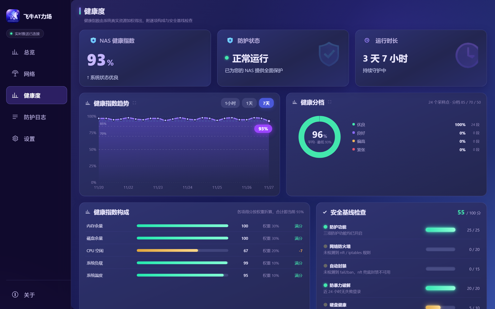
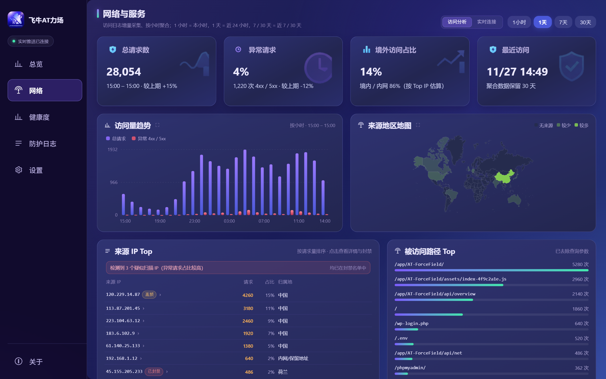
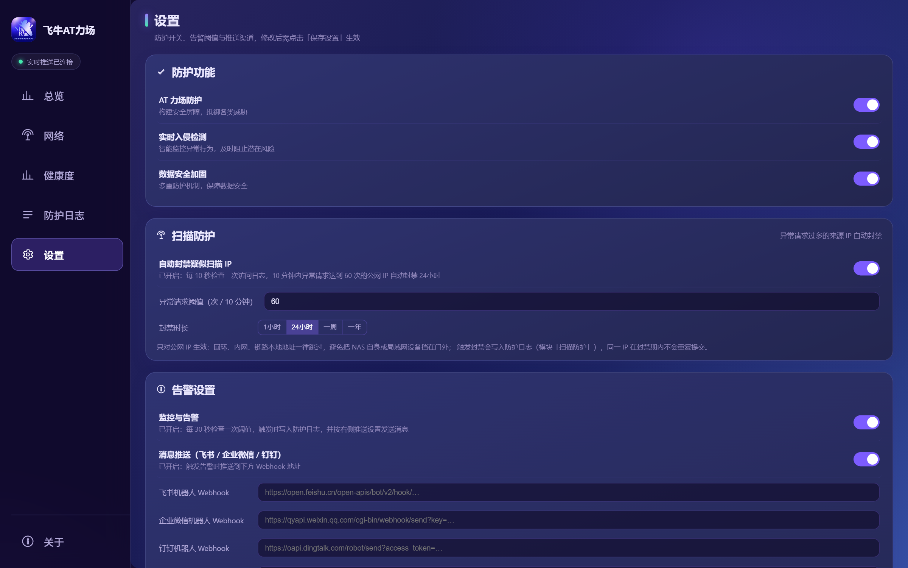

# 飞牛AT力场 · AT-ForceField

> 为飞牛 fnOS NAS 打造的一体化安全面板：真实系统指标、防护开关、网络与服务排障、扫描自动封禁、告警推送与操作审计，全部集中在一个页面里。


---

## 这是什么

飞牛AT力场（内部代号 AT-ForceField）是一个运行在飞牛 fnOS 上的轻量安全应用。它不做虚拟化、不接管流量，而是把 NAS 上分散的安全信息收拢成一块「安全仪表盘」：**现在有没有防护、机器健康状况如何、谁在连我的 NAS、有没有人在扫我的端口**，打开就能看到，并且可以直接处理。

- **单文件后端**：Go 编译的静态二进制，前端资源直接内嵌，无外部依赖、无数据库。
- **真实数据**：指标来自 `/proc`、`df`、`sensors` 等系统接口，不造数据；无法采集的项会明确标注原因。
- **开箱即用**：安装 FPK 后从应用中心进入即可，桌面端与手机端都适配。

---

## 功能特性

### 总览 · 一眼掌握防护状态
- 防护开关实时状态（AT 力场 / 入侵检测 / 数据加固），一键启停。
- **同步率**与**健康指数**双环仪表，直观反映「防护 + 健康」的整体水位。
- 运行时长、防护次数、拦截统计、查看日志等快捷入口。

### 健康度 · 真实指标与基线
- CPU、内存、各分区存储、系统负载、CPU/硬盘温度、UPS、在线用户。
- 7 天指标历史按 24 点聚合，1 小时 / 1 天 / 7 天三种粒度切换。
- 健康指数构成拆解 + 健康分档说明。
- **安全基线检查**逐项给出结论（SSH 密码登录、防火墙、fail2ban / nft 封禁、SMART、sshd 配置等），并给出修复建议。

### 网络与服务 · 谁在连我的 NAS
- 实时上行 / 下行速率、24 小时吞吐趋势、流量用量统计。
- 活动连接 Top 排行与完整明细（进程、PID、远端地址），可按需断开，默认保护系统关键端口。
- 监听端口、运行中服务、20 项服务状态总览。
- **可疑 IP 分析**：失败登录来源、归属地、次数、一键封禁 / 解封。
- **访问分析**：直接读取 nginx `access.log`，展示访问量趋势、Top IP、被扫路径、状态码分布、境内 / 境外占比与世界地图，疑似扫描来源可一键加入封禁。

### 防护 · 扫描防护与自动封禁
- 三个可独立开关的防护项：AT 力场、入侵检测、数据加固。
- **扫描防护**：阈值（默认 60 次 / 10 分钟）触发自动封禁，时长可选；优先调用 fail2ban，未安装时自动使用 nft 自建封禁表兜底。
- 回环与内网地址自动跳过，避免误伤自己。

### 告警与推送
- 健康指数、磁盘、内存、分区占用、CPU 温度、硬盘温度逐项阈值告警，可单独开关监控。
- 告警恢复通知，避免反复打扰。
- 支持飞书 / 企业微信 / 钉钉群机器人 Webhook 与 SMTP 邮件推送，四个渠道可同时启用；设置页按选项卡配置，打开时自动定位到已配置的渠道。
- 邮件支持自填 SMTP 服务器、端口与加密方式（SSL 465 / STARTTLS 587 / 无加密 25），可多收件人、支持无需认证的内网中继，发送失败自动重试 2 次。
- 设置页可测试发送；Webhook 请求带签名校验、失败重试并记录日志。
- 安全事件推送：自动封禁、异常登录、访问突增。

### 防护日志
- 记录真实操作与安全事件（级别、模块、对象、详情、来源），可筛选、按 IP 检索、展开详情。
- 支持导出 CSV，日志文件按 8 MB 轮转，前端最多展示最近若干条。

### 工程实现
- Go 单二进制内嵌前端，`unix socket + TCP` 双监听。
- SSE 实时推送 + 轮询兜底，断线自动重连。
- 配置导入 / 导出、诊断包一键导出。
- 移动端自适应布局。

---

## 界面预览

| 总览 | 健康度 |
| --- | --- |
|  |  |

| 网络与服务 · 访问分析 | 网络与服务 · 实时连接 |
| --- | --- |
|  |  |

| 防护日志 | 设置 |
| --- | --- |
|  |  |

<p align="center">
  
  &nbsp;&nbsp;
  
</p>

---

## 更新日志

> 完整版本与安装包见 [Releases](https://github.com/IMGZCQ/AT-Field/releases)，最新版本会默认展开。

<details open>
<summary><b>v0.1.86</b> · 归属地提示精简</summary>

- 连接 Top 与可疑 IP 明细中的归属地，未查询时只显示「点击查询」，点击立即查询；去掉「未查询，点查看归属查询」之类的冗余提示

</details>

<details>
<summary><b>历史版本</b> · v0.1.85 及更早（点击展开）</summary>

### v0.1.85 · 被访问路径按状态码筛选

- 「被访问路径 Top」的状态码分布改为可点击筛选：「全部」默认选中，点击某个状态码只显示该状态码对应的路径（Top 10）与总次数，再点一次回到全部
- 切换时限自动回到「全部」；筛选时面板高度保持不变，状态码区不再上下跳动；移动端胶囊加大点击区域

### v0.1.84 · 消息推送改为选项卡

- 设置页「消息推送」改为四个选项卡（飞书 / 企业微信 / 钉钉 / 邮件），一次只显示一个渠道的配置，不再把十几个输入框一次铺开
- 选项卡标签带状态圆点：已填写为绿色、未填写为灰色；打开设置时自动定位到第一个已配置的渠道
- 每个选项卡下方新增渠道配置提示（机器人添加路径 / 授权码说明）；移动端四个选项卡等宽一行，390px 下不换行、不溢出

### v0.1.83 · 新增邮件推送

- 告警推送支持邮件：可自填 SMTP 服务器、端口与加密方式（SSL 465 / STARTTLS 587 / 无加密 25），填写账号（密码 / 授权码）与收件人后，阈值告警与安全事件同步发邮件，可与飞书 / 企业微信 / 钉钉同时使用
- SMTP 服务器与收件人都填写后才启用；支持多个收件人（英文逗号分隔），发件人留空则用 SMTP 账号，邮件标题自动加「【飞牛AT力场】」前缀，中文标题按 RFC 2047 编码不乱码
- 发送失败自动重试 2 次并写入防护日志；「发送测试消息」会同时测试 Webhook 与邮件，并逐项回显失败原因
- 邮件设置随配置导出 / 导入一起保存，导入时校验字段类型；无加密（25）方式不允许账号认证，内网中继可留空账号密码

### v0.1.82 · IPv6 归属地省级参考

- 新增 zxinc 社区库作为第 5 个归属地数据源：国内 IPv6 能给出省级结果（如 240a:42c2 段 → 湖南省），显示为「中国 · 湖南省 · 中国广电」并标注「省级参考」
- zxinc 没有经纬度，只作省份参考、不参与城市坐标印证，也不计入省份分布；IPv4 与境外 IPv6 的查询行为不变
- 运营商识别补充中文名称（中国广电 / 中国移动 / 中国电信 / 中国联通等），中文库直接返回机构全名时也能正确归一

### v0.1.81 · 归属地多源比对与 CPU 温度修正

- IP 归属地改为多源比对（ip-api / ipwho.is / ip2location / iplocation）：只有两个以上数据源的城市坐标一致才显示省市，否则只显示国家与运营商并标注「地址可能不准」，修正中国 IPv6 被误报为北京的问题
- 归属地结果缓存 24 小时，单个数据源失败自动降级，不再依赖单一接口
- CPU 温度只读取 CPU 传感器（x86_pkg_temp / coretemp / k10temp / cpu-thermal / soc-thermal），不再取全系统最高温，避免主板 / GPU / 电池传感器误触发温度告警；健康度与设置页标签统一为「CPU 温度」
- 访问分析「境外访问占比」在无公网访问时显示「—」并注明内网 / 本地不计入，脚注统一为「境内公网 X%」

### v0.1.80 · IP 归属地误报修复

- 中国 IPv6 段常被 ip-api 只解析到注册机构（如 CNNIC 的北京金融街地址），改用 ASN 识别真实运营商（中国移动 / 中国电信 / 中国联通 / 中国广电等），并在归属地后标注「注册机构地址，可能不准」
- 只识别到注册机构的地址不再计入省份分布，避免把访问量错误算到北京

### v0.1.79 · 被访问路径下钻来源 IP

- 「被访问路径 Top」支持点击路径查看来源 IP：展开后列出该路径在所选时限内的 Top 5 来源 IP、请求次数与归属地，再点一次收起
- 采集时同步记录「路径 → 来源 IP」关联（每条路径每小时最多保留 10 个来源、每小时最多 200 条路径），单独按小时落盘，只保留最近 7 天；选 30 天时限时自动只统计最近 7 天并在面板内提示
- 反向代理场景若日志只记到 127.0.0.1，会尝试从日志的转发字段解析真实来源，解析不到才按 127.0.0.1 统计

### v0.1.78 · 流量用量 · 进程明细

- 「流量用量」标题旁新增「进程明细」：按进程查看所选时限内的下行 / 上行流量与占比，并显示「已归因 / 全机」覆盖率，每 5 秒自动刷新
- 明细来自内核 TCP socket 的累计字节（ss），每 3 秒差分一次、按分钟聚合，每分钟落盘一次并保留 7 天
- 只覆盖 TCP；UDP（DNS / QUIC 等）与存活短于 3 秒的连接不计入，同名进程合并为一行

### v0.1.77 · 侧栏显示版本号

- 侧边栏底部「关于」行右侧新增小字版本号，随时看到当前版本；手机顶部导航下自动隐藏，不挤占空间

### v0.1.76 · 安全基线环形图留白修正

- 环内总分缩小一档，与圆环内壁留出足够间距（1440 宽下左右各留约 19px），不再贴着环边
- 圆环下方的「安全基线 · 扣分 N」上移贴近圆环

### v0.1.75 · 安全基线环形图自适应

- 环形图整体随面板区域缩放：圆环直径、环内分数与右侧图例文字按面板大小等比放大，面板下方不再留下大片空白
- 「安全基线 · 扣分 N」由圆环内部移到圆环正下方，环心只保留总分

### v0.1.60 – v0.1.74 · 访问分析、来源地图与扫描防护

- **0.1.74** 修正来源地区地图面板被拉高、左侧趋势图下方大片空白
- **0.1.73** 地图新增中国省级视图：点击中国下钻，按省份访问量填色，可一键返回世界
- **0.1.72** 地图放大弹层按可用宽度铺满
- **0.1.71** 扫描防护与安全事件推送窗口由 10 分钟改为 1 分钟
- **0.1.70** 「健康分档」改为「安全基线构成」环形图
- **0.1.69** 设置页新增「安全事件推送」：自动封禁 / SSH 异常登录 / 访问突增
- **0.1.68** 健康度移动端适配，趋势图末点气泡自动收边
- **0.1.67** 健康度趋势左右两栏 + 健康分档环 + 24 点采样
- **0.1.66** 吞吐 / 流量 / 访问量 / 地图支持点击放大，小屏可读
- **0.1.63** 访问分析新增来源地区地图（按国家填色）
- **0.1.62** 网络页新增「流量用量」堆叠柱状图
- **0.1.61** 「访问分析」前置并默认进入
- **0.1.60** 扫描防护、疑似扫描标记与 30 天时限

### v0.1.40 – v0.1.59 · 访问分析上线与连接管理

- **0.1.56** 新增「访问分析」：增量采集 nginx access.log，展示趋势 / 来源 IP / 被扫路径 / 状态码
- **0.1.58** 默认 24 小时窗口；归属地改为按需查询
- **0.1.55** 封禁时长可选 1 小时 / 24 小时 / 一周 / 一年，选择会被记住
- **0.1.54** 断开连接增加破坏性操作防护，新增单元测试骨架
- **0.1.53** 设置页新增配置导入
- **0.1.52** 连接明细与单条断开（ss -K）
- **0.1.51** 手机端总览布局修正
- **0.1.50** 手机端防护卡两列，日志每页最少 10 条
- **0.1.49** 状态标签光晕与同步率条纹动画
- **0.1.48** 同步率进度条「斜条渐进 + 光子流动」
- **0.1.46** 首页渲染开销优化，后台暂停动画
- **0.1.45** 服务状态只显示真实检测项，新增 Docker / 应用中心识别
- **0.1.44** nft 兜底封禁 + 防火墙判定修正
- **0.1.43** 钉钉机器人推送、连接与可疑 IP 明细
- **0.1.42** 移动端全面适配

### v0.1.20 – v0.1.39 · 告警闭环与视觉打磨

- **0.1.36** 六项告警指标新增独立监控开关
- **0.1.35** 同步率回归（0–260%），标注 200% 绝对领域门槛
- **0.1.34** 告警开关改为正向语义，老配置自动迁移
- **0.1.33** 关于页新增投喂入口
- **0.1.29** 实时数据 2 秒刷新，趋势采样 30 秒
- **0.1.28** 图表 Y 轴自适应留白与柔和曲线
- **0.1.27** 告警恢复通知、飞书签名、配置 0600、CSV 导出
- **0.1.26** 推送失败重试与去重落盘、Webhook 校验、日志轮转
- **0.1.24** 修复告警阈值输入被实时刷新冲掉
- **0.1.20** 进度条渐变填充与外发光

### v0.1.0 – v0.1.19 · 从模拟到真实安全面板

- **0.1.18** 界面按设计稿全面对齐
- **0.1.17** CPU 规格区分物理核心与逻辑线程
- **0.1.16** 支持企业微信机器人
- **0.1.13** 可疑 IP 分析、fail2ban 封禁名单、IP 归属地查询
- **0.1.12** 告警设置界面化，新增「网络」页
- **0.1.10** 真实安全巡检（SSH 失败 / 防火墙 / fail2ban / SMART）、100 分制安全基线、阈值告警
- **0.1.9** 核心数据真实化：真实 CPU / 内存 / 磁盘 / 负载 / 温度健康指数，30 秒采样保留 7 天
- **0.1.0** 初次发布

</details>

---

## 快速开始

### 安装

1. 到 [Releases](https://github.com/IMGZCQ/AT-Field/releases) 下载最新版的 `AT-ForceField_<版本>.fpk`（每个版本都附完整更新说明与 SHA256）。
2. 在飞牛应用中心「手动安装」选择该文件，等待安装完成。
3. 从应用中心打开「飞牛AT力场」。

直连地址默认为 `http://127.0.0.1:9971`（仅监听回环），经由 fnOS 网关访问时路径为 `/app/AT-ForceField`。

### 首次使用建议

1. 打开「设置」，按需开启健康 / 磁盘 / 内存 / 温度告警，并填写群机器人 Webhook 后点「测试」。
2. 在「网络与服务」里填好 nginx 访问日志路径（未填时自动探测），开启访问分析。
3. 打开「防护」，按需启用扫描防护；建议先保持默认阈值观察几天，再调整。

---

## 从源码构建

环境要求：**Go 1.22+**、**Node.js 18+**、Windows 下需可用的 `tar`（Windows 10 1803+ 自带）。

```bat
git clone https://github.com/IMGZCQ/AT-Field.git
cd AT-Field
build.bat
```

构建脚本会依次完成：读取 `fpk/manifest` 版本号 → 构建前端 → 交叉编译 Linux `amd64` / `arm64` → 组装 FPK 目录 → 打包。

产物：

- `飞牛AT力场_<版本>.fpk`（带版本号，发布用）
- `AT-ForceField.fpk`（纯 ASCII 文件名，脚本 / 镜像站用）

非 Windows 环境可手动执行等价步骤：`npm install && npm run build`（`code/frontend`）→ `GOOS=linux GOARCH=amd64 CGO_ENABLED=0 go build -trimpath -ldflags "-s -w -X main.Version=<版本>" -o src/at-forcefield-linux-amd64 ./cmd/server`（`code`，arm64 同理）→ 按 `build.bat` 中的目录结构打包 FPK。

### 发布新版本

改完代码后按顺序执行，Release 与更新说明会自动同步：

1. 把 `fpk/manifest` 的 `version` 加 `0.0.1`，并在 `changelog=` 最前面加上本版 `•` 条目。
2. `build.bat` 构建 FPK。
3. `powershell -ExecutionPolicy Bypass -File .\release.ps1 -Push`
   - 推送当前分支到 `origin`
   - 按 `version` 创建 / 更新 tag `v<版本>` 与 GitHub Release，说明取自 `changelog`
   - 上传 `AT-ForceField_<版本>.fpk` 并写入 SHA256

脚本可重复执行：同一版本再次运行只会更新说明与附件，不会产生重复 Release。

---

## 运行时参数

| 环境变量 | 说明 | 默认值 |
| --- | --- | --- |
| `ATFF_HOME` | 运行根目录 | 当前工作目录 |
| `ATFF_DATA_DIR` | 持久化数据目录（配置、采样、审计、访问聚合） | `$ATFF_HOME/data` |
| `ATFF_ADDR` | HTTP 监听地址 | `127.0.0.1:9971` |
| `ATFF_SOCK` | unix socket 路径 | `$ATFF_HOME/AT-ForceField.sock` |
| `ATFF_BASE_PATH` | 统一网关前缀（反代时由网关注入） | 空 |
| `ATFF_NGINX_LOG` | nginx `access.log` 路径（访问分析） | 自动探测 |

> 反向代理场景下会优先使用 `X-Forwarded-For` 解析真实客户端 IP；请求路径会自动剥离网关前缀，无尾斜杠时 301 回补。

---

## 主要接口

| 方法 | 路径 | 说明 |
| --- | --- | --- |
| GET | `/api/overview` | 总览快照 |
| GET | `/api/stream` | SSE 实时推送 |
| GET | `/api/health/history` | 指标历史（按范围聚合） |
| GET | `/api/net` | 网络速率、端口、服务 |
| GET | `/api/net/connections` | 活动连接明细 |
| POST | `/api/net/connections/kill` | 断开指定连接 |
| GET / POST | `/api/logs`、`/api/alerts` | 审计日志、告警记录 |
| POST | `/api/ip/ban`、`/api/ip/unban` | 封禁 / 解封 IP |
| GET | `/api/web/summary` | 访问分析汇总 |
| GET / PUT | `/api/config` | 读取 / 保存配置 |
| GET | `/api/diagnostics` | 导出诊断包 |
| POST | `/api/shield/enable`、`/api/shield/disable` | 启停防护 |
| POST | `/api/alert/test` | 测试告警推送 |

---

## 目录结构

```text
AT-Field/
├─ code/
│  ├─ cmd/server/         服务端入口（HTTP + unix socket）
│  ├─ internal/           配置、指标采集、网络、巡检、封禁、告警、审计、访问分析、API
│  ├─ frontend/           React + Vite 前端（构建后内嵌进二进制）
│  └─ data/               默认数据目录（运行后生成）
├─ fpk/                   FPK 元数据、图标、启动脚本、安装向导
├─ assets/                界面设计素材
├─ docs/screenshots/      README 截图
├─ build.bat              一键构建脚本
├─ release.ps1            发布脚本（推送 + 同步 GitHub Release）
└─ .gitignore
```

---

## 数据与隐私

- 所有指标、配置、审计与访问聚合数据都保存在本机数据目录，**不会上传到任何服务器**。
- 公网 IP 归属地按需查询公共接口（`ip-api.com`），结果缓存；内网地址仅在本地判断。
- 告警只会发送到你亲自填写的群机器人 Webhook。
- 封禁 / 断开连接会真实修改系统状态，请确认影响后再操作。

---

## 技术栈

- 后端：Go 1.22，标准库 HTTP + SSE，无第三方依赖（`go.mod` 仅有模块声明）。
- 前端：React 18 + Vite 5，原生 CSS 变量主题，无 UI 框架。
- 打包：fnOS FPK（Linux amd64 / arm64 双架构）。

---

## 关于

- 开发者：**米恋泥**
- 企鹅群：**1039270739**
- 投喂支持：扫码赞赏，请开发者喝杯咖啡

<p align="center">
  
</p>

您的支持是我持续开发和维护的动力！感谢每一位用户的认可与鼓励。
