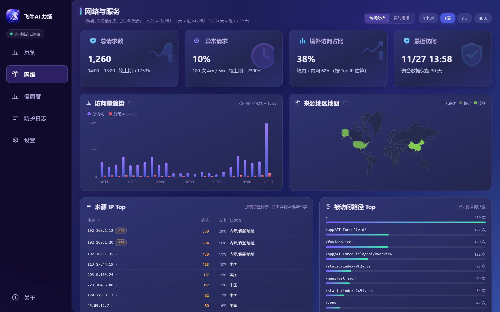
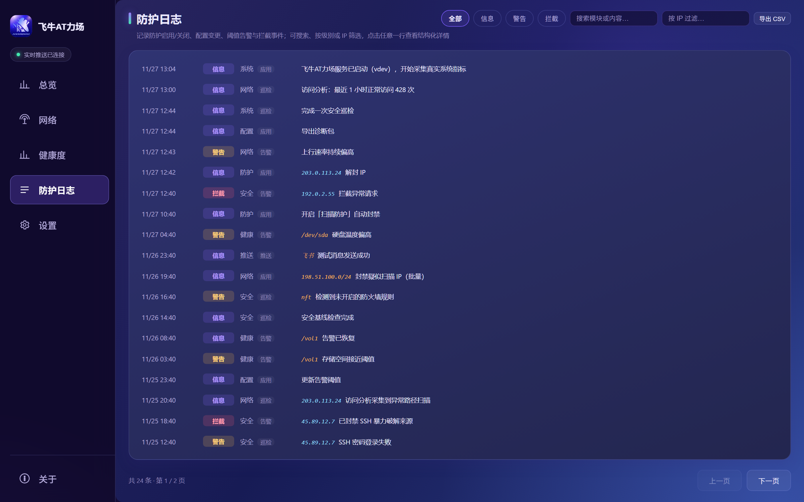
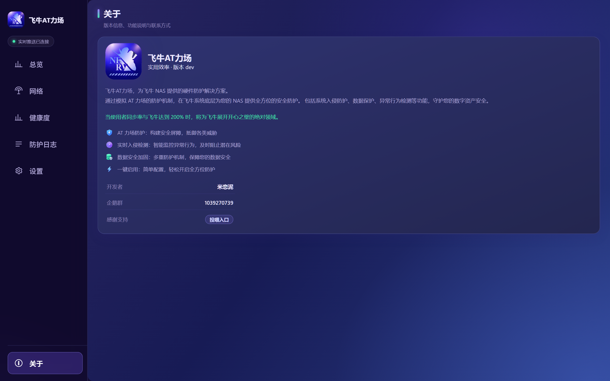
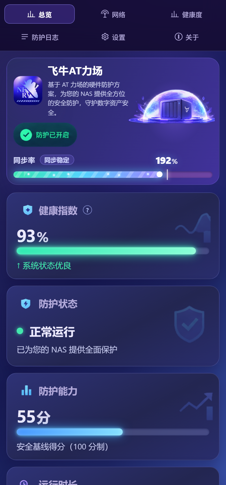

# 飞牛AT力场 · AT-ForceField

> 为飞牛 fnOS NAS 打造的一体化安全面板：真实系统指标、防护开关、网络与服务排障、扫描自动封禁、告警推送与操作审计，全部集中在一个页面里。


---

## 这是什么

飞牛AT力场（内部代号 AT-ForceField）是一个运行在飞牛 fnOS 上的轻量安全应用。它不做虚拟化、不接管流量，而是把 NAS 上分散的安全信息收拢成一块「安全仪表盘」：**现在有没有防护、机器健康状况如何、谁在连我的 NAS、有没有人在扫我的端口**，打开就能看到，并且可以直接处理。

- **单文件后端**：Go 编译的静态二进制，前端资源直接内嵌，无外部依赖、无数据库。
- **真实数据**：指标来自 `/proc`、`df`、`sensors` 等系统接口，不造数据；无法采集的项会明确标注原因。
- **开箱即用**：安装 FPK 后从应用中心进入即可，桌面端与手机端都适配。

---

## 功能特性

### 总览 · 一眼掌握防护状态
- 防护开关实时状态（AT 力场 / 入侵检测 / 数据加固），一键启停。
- **同步率**与**健康指数**双环仪表，直观反映「防护 + 健康」的整体水位。
- 运行时长、防护次数、拦截统计、查看日志等快捷入口。

### 健康度 · 真实指标与基线
- CPU、内存、各分区存储、系统负载、CPU/硬盘温度、UPS、在线用户。
- 7 天指标历史按 24 点聚合，1 小时 / 1 天 / 7 天三种粒度切换。
- 健康指数构成拆解 + 健康分档说明。
- **安全基线检查**逐项给出结论（SSH 密码登录、防火墙、fail2ban / nft 封禁、SMART、sshd 配置等），并给出修复建议。

### 网络与服务 · 谁在连我的 NAS
- 实时上行 / 下行速率、24 小时吞吐趋势、流量用量统计。
- 活动连接 Top 排行与完整明细（进程、PID、远端地址），可按需断开，默认保护系统关键端口。
- 监听端口、运行中服务、20 项服务状态总览。
- **可疑 IP 分析**：失败登录来源、归属地、次数、一键封禁 / 解封。
- **访问分析**：直接读取 nginx `access.log`，展示访问量趋势、Top IP、被扫路径、状态码分布、境内 / 境外占比与世界地图，疑似扫描来源可一键加入封禁。

### 防护 · 扫描防护与自动封禁
- 三个可独立开关的防护项：AT 力场、入侵检测、数据加固。
- **扫描防护**：阈值（默认 60 次 / 10 分钟）触发自动封禁，时长可选；优先调用 fail2ban，未安装时自动使用 nft 自建封禁表兜底。
- 回环与内网地址自动跳过，避免误伤自己。

### 告警与推送
- 健康指数、磁盘、内存、分区占用、CPU 温度、硬盘温度逐项阈值告警，可单独开关监控。
- 告警恢复通知，避免反复打扰。
- 支持飞书 / 企业微信 / 钉钉群机器人 Webhook，设置页可测试发送；请求带签名校验、失败重试并记录日志。
- 安全事件推送：自动封禁、异常登录、访问突增。

### 防护日志
- 记录真实操作与安全事件（级别、模块、对象、详情、来源），可筛选、按 IP 检索、展开详情。
- 支持导出 CSV，日志文件按 8 MB 轮转，前端最多展示最近若干条。

### 工程实现
- Go 单二进制内嵌前端，`unix socket + TCP` 双监听。
- SSE 实时推送 + 轮询兜底，断线自动重连。
- 配置导入 / 导出、诊断包一键导出。
- 移动端自适应布局。

---

## 界面预览

| 总览 | 网络与服务 |
| --- | --- |
|  |  |

| 健康度 | 防护日志 |
| --- | --- |
|  |  |

| 设置 | 关于 |
| --- | --- |
|  |  |

<p align="center">
  
  &nbsp;&nbsp;
  
</p>

---

## 快速开始

### 安装

1. 下载 `飞牛AT力场_<版本>.fpk`。
2. 在飞牛应用中心「手动安装」选择该文件，等待安装完成。
3. 从应用中心打开「飞牛AT力场」。

直连地址默认为 `http://127.0.0.1:9971`（仅监听回环），经由 fnOS 网关访问时路径为 `/app/AT-ForceField`。

### 首次使用建议

1. 打开「设置」，按需开启健康 / 磁盘 / 内存 / 温度告警，并填写群机器人 Webhook 后点「测试」。
2. 在「网络与服务」里填好 nginx 访问日志路径（未填时自动探测），开启访问分析。
3. 打开「防护」，按需启用扫描防护；建议先保持默认阈值观察几天，再调整。

---

## 从源码构建

环境要求：**Go 1.22+**、**Node.js 18+**、Windows 下需可用的 `tar`（Windows 10 1803+ 自带）。

```bat
git clone https://github.com/IMGZCQ/AT-Field.git
cd AT-Field
build.bat
```

构建脚本会依次完成：读取 `fpk/manifest` 版本号 → 构建前端 → 交叉编译 Linux `amd64` / `arm64` → 组装 FPK 目录 → 打包。

产物：

- `飞牛AT力场_<版本>.fpk`（带版本号，发布用）
- `AT-ForceField.fpk`（纯 ASCII 文件名，脚本 / 镜像站用）

非 Windows 环境可手动执行等价步骤：`npm install && npm run build`（`code/frontend`）→ `GOOS=linux GOARCH=amd64 CGO_ENABLED=0 go build -trimpath -ldflags "-s -w -X main.Version=<版本>" -o src/at-forcefield-linux-amd64 ./cmd/server`（`code`，arm64 同理）→ 按 `build.bat` 中的目录结构打包 FPK。

---

## 运行时参数

| 环境变量 | 说明 | 默认值 |
| --- | --- | --- |
| `ATFF_HOME` | 运行根目录 | 当前工作目录 |
| `ATFF_DATA_DIR` | 持久化数据目录（配置、采样、审计、访问聚合） | `$ATFF_HOME/data` |
| `ATFF_ADDR` | HTTP 监听地址 | `127.0.0.1:9971` |
| `ATFF_SOCK` | unix socket 路径 | `$ATFF_HOME/AT-ForceField.sock` |
| `ATFF_BASE_PATH` | 统一网关前缀（反代时由网关注入） | 空 |
| `ATFF_NGINX_LOG` | nginx `access.log` 路径（访问分析） | 自动探测 |

> 反向代理场景下会优先使用 `X-Forwarded-For` 解析真实客户端 IP；请求路径会自动剥离网关前缀，无尾斜杠时 301 回补。

---

## 主要接口

| 方法 | 路径 | 说明 |
| --- | --- | --- |
| GET | `/api/overview` | 总览快照 |
| GET | `/api/stream` | SSE 实时推送 |
| GET | `/api/health/history` | 指标历史（按范围聚合） |
| GET | `/api/net` | 网络速率、端口、服务 |
| GET | `/api/net/connections` | 活动连接明细 |
| POST | `/api/net/connections/kill` | 断开指定连接 |
| GET / POST | `/api/logs`、`/api/alerts` | 审计日志、告警记录 |
| POST | `/api/ip/ban`、`/api/ip/unban` | 封禁 / 解封 IP |
| GET | `/api/web/summary` | 访问分析汇总 |
| GET / PUT | `/api/config` | 读取 / 保存配置 |
| GET | `/api/diagnostics` | 导出诊断包 |
| POST | `/api/shield/enable`、`/api/shield/disable` | 启停防护 |
| POST | `/api/alert/test` | 测试告警推送 |

---

## 目录结构

```text
AT-Field/
├─ code/
│  ├─ cmd/server/         服务端入口（HTTP + unix socket）
│  ├─ internal/           配置、指标采集、网络、巡检、封禁、告警、审计、访问分析、API
│  ├─ frontend/           React + Vite 前端（构建后内嵌进二进制）
│  └─ data/               默认数据目录（运行后生成）
├─ fpk/                   FPK 元数据、图标、启动脚本、安装向导
├─ assets/                界面设计素材
├─ docs/screenshots/      README 截图
├─ build.bat              一键构建脚本
└─ .gitignore
```

---

## 数据与隐私

- 所有指标、配置、审计与访问聚合数据都保存在本机数据目录，**不会上传到任何服务器**。
- 公网 IP 归属地按需查询公共接口（`ip-api.com`），结果缓存；内网地址仅在本地判断。
- 告警只会发送到你亲自填写的群机器人 Webhook。
- 封禁 / 断开连接会真实修改系统状态，请确认影响后再操作。

---

## 技术栈

- 后端：Go 1.22，标准库 HTTP + SSE，无第三方依赖（`go.mod` 仅有模块声明）。
- 前端：React 18 + Vite 5，原生 CSS 变量主题，无 UI 框架。
- 打包：fnOS FPK（Linux amd64 / arm64 双架构）。

---

## 关于

- 开发者：**米恋泥**
- 企鹅群：**1039270739**
- 本项目为非官方应用，与飞牛官方无关；使用前请自行评估风险。

如果这个工具帮到了你，欢迎在群里反馈问题或提出需求。
